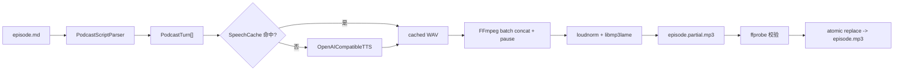

# 轻量双人稿转播客：技术调研与实施方案

状态：建议实施

调研日期：2026-08-08

目标：用户提供格式化双人文稿，VoxFlow 输出一个可播放的 MP3 文件

## 1. 结论

这个功能应当实现，但必须保持为一个独立、无状态的轻量命令，而不是扩展成新的媒体工程系统。

建议的第一版只有一条主路径：

```text
双人 Markdown 文稿
  -> 严格解析和校验
  -> 按 speaker turn 调用外部 OpenAI-compatible TTS 服务
  -> 复用本地内容寻址缓存
  -> FFmpeg 插入停顿、拼接、响度归一化
  -> 原子写入 MP3
```

推荐命令形态：

```bash
voxflow --json podcast render episode.md \
  --voice "主持人=zf_xiaobei" \
  --voice "嘉宾=zm_yunxi" \
  --base-url http://127.0.0.1:8880/v1 \
  --model kokoro \
  --out /absolute/path/episode.mp3
```

第一版明确不做：

- 不创建 VoxFlow project；
- 不进入 transcript、timeline、revision 或 artifact catalog；
- 不增加新的数据库表或持久化 job 类型；
- 不把 Kokoro、CosyVoice、Qwen3-TTS、Torch 或 ONNX 装进 VoxFlow；
- 不做自动写稿、资料检索或 NotebookLM 式内容生成；
- 不做 Web、MCP、BGM、SFX、字幕、多人抢话或整场对话模型；
- 不在 VoxFlow 内负责声音克隆注册和授权流程。

VoxFlow 只承担约 350–500 行生产代码的“胶水层”：脚本解析、通用 HTTP 请求、缓存编排和 FFmpeg 输出。模型加载、GPU、声线管理和推理服务全部交给外部仓库或云服务。

## 2. 为什么不复用现有 media project

VoxFlow 当前的 TTS 能力是“已有媒体中的局部语音替换”，并不是“从零生成语音”。强行复用会把一个简单功能变成跨 schema 的重构。

当前约束包括：

- `ProjectStore.create()` 必须接收真实音视频文件，并用 `ffprobe` 建立 source artifact；
- `TimelineClip` 必须有 `source_segment_id`、`source_in_ms` 和 `source_out_ms`；
- `SpeechService.start()` 必须基于现有 `project_id`、`clip_id` 和 `expected_revision`；
- `Job.kind` 只允许 `transcribe`、`export`、`speech_replace`，每个 job 必须有 `project_id`；
- 现有 mixed renderer 以原媒体为第一个 FFmpeg input，再附加 replacement artifacts。

为了让纯文本进入这套模型，需要引入 `script project`、可选 source、synthetic clip、silence clip、新 artifact 类型、新 job 类型、schema migration、CLI/MCP/Web contract 和大量回归测试。这些工作对于“顺带提供一个稿件转 MP3 功能”没有足够收益。

应复用的只有现成基础设施：

- `typer` CLI 和统一 JSON envelope；
- `requests`，它已经存在于 `voxflow[tts]` extra；
- `SpeechCache` 的 SHA-256 内容寻址和完整性检查；
- `Settings.tts_cache_dir`；
- `DependencyError`、`ValidationError` 等错误类型；
- 已被 `doctor` 验证的 FFmpeg、ffprobe 和 `libmp3lame`。

这也意味着该功能可以独立演进或未来删除，不影响 VoxFlow 的编辑协议。

## 3. 产品边界

### 3.1 第一版用户故事

用户已经写好一份双人对谈稿，并且知道两位 speaker 分别使用哪一个 TTS voice。用户执行一次 CLI 命令，等待 VoxFlow 输出 MP3。若中途失败或修改少量文本后重新执行，未变化的 turn 应直接命中缓存。

### 3.2 第一版支持

- 恰好两位 speaker；
- 中文、英文或混合文本，实际语言能力由 TTS provider 决定；
- 每位 speaker 映射一个 voice ID；
- 每个 turn 独立合成；
- 统一默认停顿，以及稿件中的显式停顿；
- provider/model/voice/text/speed 维度的本地缓存；
- 单声道 MP3 输出；
- FFmpeg 响度归一化；
- 输出前完整校验和原子替换；
- `--json` 结构化结果与普通人类可读模式。

### 3.3 第一版不支持

- 自动生成或润色对谈稿；
- 根据 speaker 名称自动猜声线；
- 在 VoxFlow 中上传、训练或克隆声音；
- turn 内的多角色、重叠语音或抢话；
- 情绪标签的跨 provider 翻译；
- 背景音乐、片头、片尾和音效；
- SRT/VTT；
- Web 编辑器和逐句试听 UI；
- 后台持久化任务、取消和轮询；
- 生成结果进入现有 project history。

这些能力不是技术上做不到，而是会破坏“轻量旁路组件”的目标。

## 4. 外部依赖调研

以下 GitHub 数据为 2026-08-08 快照。Stars 只用于判断社区活跃度，不代表音质。模型和 wrapper 的许可证必须分别核对。

### 4.1 OpenAI-compatible TTS 是最小公共边界

多个本地 TTS 服务和云服务已经收敛到：

```http
POST /v1/audio/speech
Content-Type: application/json
Authorization: Bearer <optional>
```

公共请求子集为：

```json
{
  "model": "kokoro",
  "input": "欢迎收听这一期节目。",
  "voice": "voice-id",
  "response_format": "wav",
  "speed": 1.0
}
```

这个子集已被 Kokoro-FastAPI、Speaches、部分 CosyVoice/Qwen3-TTS wrapper 和 OpenAI 官方 Speech API 采用。VoxFlow 不需要安装 OpenAI Python SDK，使用已有的 `requests` 即可。

第一版只使用公共字段，不发送 provider-specific `instructions`、`instruct`、`emotion`、`reference_audio` 等扩展字段。这样能够避免 provider 分支和能力协商。

统一请求 WAV，而不是让 provider 直接返回最终 MP3，原因是：

- WAV 便于 ffprobe 验证；
- 不会对每个 turn 先做有损压缩，再重新编码最终 MP3；
- FFmpeg 可以统一采样率、声道和 sample format；
- OpenAI 官方文档也建议 WAV/PCM 用于较低响应延迟。

### 4.2 推荐依赖矩阵

| 外部项目 | 活跃度/许可证 | 部署与能力 | 对本功能的结论 |
|---|---|---|---|
| [Kokoro-FastAPI](https://github.com/remsky/Kokoro-FastAPI) | 5.3k stars，Apache-2.0，2026-08-07 有提交 | Kokoro-82M；OpenAI-compatible；中文；CPU、NVIDIA、AMD、Apple MPS；Docker/本机均可 | **默认本地示例**。最轻、接口成熟、不把模型依赖带进 VoxFlow |
| [Speaches](https://github.com/speaches-ai/speaches) | 3.6k stars，MIT，2026-08-07 有提交 | OpenAI-compatible；Kokoro/Piper；CPU/GPU；Docker；同时带 STT | **通用 sidecar 候选**。用户已有 Speaches 时可直接复用，但为了一个 TTS 功能单独部署会比 Kokoro-FastAPI稍重 |
| [CosyVoice Docker](https://github.com/neosun100/cosyvoice-docker) | 82 stars，Apache-2.0，第三方 wrapper | Fun-CosyVoice3-0.5B；`/v1/audio/speech`；中文、方言、voice_id；NVIDIA 8GB+ | **中文质量优先方案**。接口正好兼容，但 wrapper 社区较小，部署文档应固定镜像版本而不是 `latest` |
| [Qwen3-TTS](https://github.com/QwenLM/Qwen3-TTS) | 12.9k stars，Apache-2.0 | 官方 0.6B/1.7B 模型；中文预置声线、声音设计和克隆；官方建议独立 Python 环境 | **模型候选，不直接依赖**。社区 OpenAI wrapper 当前成熟度低，应让用户自行提供兼容服务 URL |
| [Kokoro-82M](https://github.com/hexgrad/kokoro) | 8.3k stars，Apache-2.0 | 82M 参数；普通话支持；Mac 可用 MPS | **适合外部服务**。不直接装入 VoxFlow，否则仍会引入 PyTorch、soundfile、espeak/misaki 等依赖 |
| [MeloTTS](https://github.com/myshell-ai/MeloTTS) | 7.6k stars，MIT；最后提交 2024-12 | 中文/中英混合；CPU 实时 | 技术上轻，但没有标准 sidecar API且维护较慢；不做内置 adapter |
| [sherpa-onnx](https://github.com/k2-fsa/sherpa-onnx) | 14k stars，Apache-2.0，活跃 | ONNX、跨平台、中文 Matcha/VITS/ZipVoice；多语言 API | 适合嵌入式或完全离线部署，但集成和模型选择面过大；除非已有服务，否则不是第一版依赖 |
| [edge-tts](https://github.com/rany2/edge-tts) | 11.7k stars，主体 LGPL-3.0 | 无 API key 调用 Microsoft Edge 在线语音；多语言、语速/音调；输出 MP3/SRT | **只作个人测试回退**。它依赖未承诺的在线服务，不应作为产品默认或 SLA 依赖 |
| [openai-edge-tts](https://github.com/travisvn/openai-edge-tts) | 2k stars，GPL-3.0；项目注明倾向个人使用 | 把 edge-tts 包成 `/v1/audio/speech` | 可验证 VoxFlow 的通用 adapter，但商业使用和服务条款风险明显，不推荐正式默认 |
| [openedai-speech](https://github.com/matatonic/openedai-speech) | 860 stars，AGPL-3.0，已归档 | OpenAI-compatible；XTTSv2/Piper | 已归档且许可证传染性更强，不作为推荐依赖 |

### 4.3 推荐 provider 顺序

第一版文档建议提供三种现成部署示例，但 VoxFlow 代码只有一个 adapter：

1. **零 GPU / Mac / 开发机**：Kokoro-FastAPI；
2. **有 NVIDIA GPU、中文质量优先**：CosyVoice Docker；
3. **已有云端或内部服务**：任何 OpenAI-compatible Speech API。

高质量声音克隆不属于第一版。如果以后需要，CosyVoice Docker 已经提供独立的 `/v1/voices/create`，Qwen3-TTS 也有相应外部服务实现。注册 voice 应当在 provider 控制面完成，VoxFlow 只接收最终 voice ID。

### 4.4 为什么不直接依赖 `podcast_tts`

[podcast_tts](https://github.com/puntorigen/podcast_tts) 已实现多人对话、停顿、BGM 和字幕，表面上很接近需求，但不适合成为 VoxFlow 依赖：

- 基础依赖无条件包含 `torch`、`torchaudio`、`numpy`、`soundfile`；
- engine 还会增加 ChatTTS、Chatterbox 或 Kokoro；
- 它面向进程内模型推理，而不是外部 HTTP 服务；
- VoxFlow 默认安装当前只有 4 个轻量依赖，引入它会显著扩大安装、锁文件和平台兼容面；
- 其音频混合使用 Torch waveform，会建立第二套音频处理栈，而 VoxFlow 已经强依赖 FFmpeg。

因此应借鉴它的 turn 顺序、pause 和 cache 思路，但不依赖其 Python 包。

Open Notebook、Podcastfy 等完整系统同理：它们解决资料摄取、LLM 写稿、speaker profile 和 Web 管理，远大于当前需求。

## 5. 最小架构



只有两个新增业务组件：

1. `PodcastService`：解析、校验、缓存编排和统计；
2. `OpenAICompatibleTTS` + `PodcastFFmpegRenderer`：放在同一个 infrastructure 模块中，负责 HTTP 和 FFmpeg 边界。

不需要 domain reducer、project store、catalog、worker 或 schema 文件。

## 6. 文稿格式

### 6.1 示例

```markdown
# 第一期：轻量 TTS

主持人：欢迎收听这一期节目。今天我们聊聊，怎样把双人文稿做成播客。

嘉宾: 关键不是再造一个音频工作站，而是把模型服务和拼接流程接起来。

@pause 700ms

主持人：所以第一版甚至不需要项目和时间线？

嘉宾：对。输入文稿，输出 MP3，就够了。
```

### 6.2 严格语法

- UTF-8 文本；
- `#` 开头的行是注释或 Markdown 标题，忽略；
- 空行忽略，不隐式增加停顿；
- speaker 行格式为 `NAME: TEXT` 或 `NAME：TEXT`；
- 只在第一个半角/全角冒号处分割，正文中的冒号保留；
- 以两个或更多空格开头的非空行，追加到前一个 speaker turn；
- `@pause 500ms` 或 `@pause 1.2s` 修改前一个 turn 的 `pause_after_ms`；
- `@pause` 必须位于某个 speaker turn 之后；
- speaker 名称去除首尾空格后必须非空；
- 正文去除首尾空格后必须非空；
- 第一版最终必须恰好出现两种 speaker 名称。

### 6.3 安全限制

建议默认限制：

| 项目 | 限制 | 原因 |
|---|---:|---|
| speaker 数量 | 恰好 2 | 产品目标和 voice 配置简单明确 |
| turn 数量 | 1–500 | 防止异常输入和 FFmpeg 参数膨胀 |
| 单 turn 字符数 | 1–4000 | 兼容 Edge/OpenAI 类服务常见请求限制 |
| 总字符数 | 不超过 100,000 | 控制费用、时间和缓存占用 |
| pause | 0–10,000 ms | 防止拼写错误生成极长静音 |
| 输入文件 | 建议不超过 1 MiB | 文稿不应成为任意大文件入口 |

超过单 turn 限制时第一版直接报带行号的错误，不自动切句。自动切句会改变用户的表演和停顿语义，也会引入新的语言处理逻辑。

### 6.4 内部数据结构

```python
class PodcastTurn(BaseModel):
    index: int
    source_line: int
    speaker: str
    text: str
    pause_after_ms: int


class PodcastScript(BaseModel):
    turns: list[PodcastTurn]
    speakers: tuple[str, str]
    total_characters: int
```

不需要把这些模型加入 `voxflow/domain/models.py`，它们属于旁路 application use case，不是稳定编辑协议。

## 7. CLI 契约

### 7.1 命令

```bash
voxflow podcast render INPUT \
  --voice NAME=VOICE \
  --voice NAME=VOICE \
  --out OUTPUT.mp3 \
  [--base-url URL] \
  [--model MODEL] \
  [--speed 1.0] \
  [--gap-ms 350] \
  [--timeout 300]
```

参数建议：

| 参数 | 默认值 | 说明 |
|---|---|---|
| `INPUT` | 必填 | UTF-8 Markdown/纯文本稿件 |
| `--voice` | 必填两次 | `speaker=voice_id`；speaker 必须和文稿完全一致 |
| `--out` | 必填 | 绝对或相对 MP3 路径；默认不覆盖已有文件 |
| `--base-url` | `http://127.0.0.1:8880/v1` | 不包含 `/audio/speech` 的 API base URL |
| `--model` | `kokoro` | 原样发送给 provider |
| `--speed` | `1.0` | 允许 0.5–2.0；进入 cache key |
| `--gap-ms` | `350` | 未显式写 `@pause` 时的 turn 间停顿 |
| `--timeout` | `300` | 单次 HTTP read timeout，秒 |

API key 只从环境变量读取：

```text
VOXFLOW_PODCAST_TTS_API_KEY
```

可以选择性回退到 `OPENAI_API_KEY`，但绝不提供 `--api-key` 命令行参数，避免密钥进入 shell history、进程列表和支持日志。

### 7.2 普通输出

```text
Parsed 42 turns for speakers: 主持人, 嘉宾
Synthesizing 42 turns (17 cache hits)...
Rendering mono MP3...
Created /absolute/path/episode.mp3 (00:18:42)
```

进度写 stderr，最终路径写 stdout，以保持脚本可组合。

### 7.3 JSON 输出

```json
{
  "ok": true,
  "data": {
    "path": "/absolute/path/episode.mp3",
    "duration_ms": 1122000,
    "turn_count": 42,
    "speaker_count": 2,
    "cache_hits": 17,
    "cache_misses": 25,
    "provider": "openai-compatible",
    "model": "kokoro"
  },
  "meta": {
    "request_id": "req_...",
    "schema_version": 1
  }
}
```

不注册 artifact，因此不返回 `artifact_id` 或 `project_id`。

## 8. HTTP adapter 设计

### 8.1 请求

```python
class OpenAICompatibleTTS:
    def synthesize(
        self,
        *,
        text: str,
        voice: str,
        model: str,
        speed: float,
        output_path: Path,
    ) -> None:
        ...
```

具体行为：

1. `endpoint = base_url.rstrip("/") + "/audio/speech"`；
2. 拒绝带 username/password userinfo 的 URL；
3. 仅允许 `http` 和 `https`；
4. `Authorization` header 只有在环境变量存在时才发送；
5. POST 公共 JSON 子集，并固定 `response_format="wav"`；
6. `requests.post(..., stream=True, timeout=(10, configured_timeout))`；
7. 禁止自动跨站重定向，避免 Authorization header 被带到未知目标；
8. 响应写到 `*.partial.wav`，限制单 turn 最大响应，例如 100 MiB；
9. HTTP 非 2xx 时只保留截断后的状态和响应摘要，不记录用户正文；
10. 用 ffprobe 验证至少有一个 audio stream、duration 大于 0；
11. 验证成功后原子改名为最终临时 WAV。

provider 返回的 `Content-Type` 只能用作提示，不能代替 ffprobe。不同兼容服务可能返回 `audio/wav`、`application/octet-stream`，流式 WAV 头也可能使用未知长度 sentinel。

### 8.2 不做 provider capability discovery

第一版不调用 `/v1/models` 或 `/v1/voices`：

- 这些列表端点并不完全标准；
- 用户已经显式提供 model 和两个 voice ID；
- 真实合成请求本身就是最可靠的兼容性测试。

### 8.3 不支持 provider-specific 参数

CosyVoice 的 `instruct`、OpenAI 的 `instructions`、Kokoro 的 `lang_code`、Qwen 的 voice design 等都暂不进入 VoxFlow CLI。如果将来确有需求，优先增加一个原样 JSON 文件 `--provider-options`，而不是在核心代码里建立模型能力树。

## 9. 缓存和中断恢复

复用现有 `SpeechCache`，使用独立子目录：

```text
VOXFLOW_HOME/tts-cache/podcast-v1/
```

cache key 配置：

```json
{
  "schema_version": 1,
  "provider": "openai-compatible",
  "base_url": "http://127.0.0.1:8880/v1",
  "model": "kokoro",
  "voice": "voice-id",
  "speed": 1.0,
  "response_format": "wav",
  "text_sha256": "..."
}
```

注意：

- API key 不进入 cache key 或 manifest；
- 文稿正文不写进 cache manifest，只写 `text_sha256`；
- base URL 应归一化后进入 key，避免不同 provider 意外共用音频；
- provider 服务升级但 model 名称未变化时，旧缓存仍会命中。需要重做时用户可改变 model 标签，例如 `kokoro-1.0.0`，或以后增加 `--cache-bust`；
- 命中 cache 时仍进行现有 SHA-256 完整性校验；
- 进程中断后重新运行，相同 turn 自动命中已完成缓存；
- 不需要 job 表、resume manifest 或 worker。

如果两个 speaker 恰好说相同文本，voice 不同会产生不同 cache key。

## 10. FFmpeg 渲染方案

### 10.1 中间格式

所有 provider WAV 在 FFmpeg 中归一为：

```text
PCM float pipeline -> 44.1 kHz -> mono
```

最终编码：

```text
MP3 / libmp3lame / mono / 44.1 kHz / 128 kbps
```

双人不等于双声道。普通对谈播客保持 mono 可以减少文件体积，也避免耳机中 speaker 被硬分到左右声道的不自然体验。

### 10.2 停顿

每个 turn 携带 `pause_after_ms`。未显式配置时使用 `--gap-ms`，最后一个 turn 默认 0。

FFmpeg 对每个输入使用：

```text
aresample=44100,
aformat=sample_fmts=fltp:channel_layouts=mono,
apad=pad_dur=<seconds>
```

随后用 audio-only concat filter 串联：

```text
[a0][a1]...[aN]concat=n=N:v=0:a=1[out]
```

本机 FFmpeg 8.1.1 探针已经验证：0.8 秒 WAV + 0.3 秒 `apad` + 1.2 秒 WAV，经过 concat、loudnorm 和 MP3 编码后，ffprobe 报告总时长精确为 2.300 秒。

### 10.3 分批渲染

不要把 500 个输入一次性全部交给 FFmpeg。建议每 64 个 turn 生成一个临时 PCM WAV chunk：

```text
turn WAVs (<=64)
  -> normalized chunk-000.wav

chunk WAVs
  -> final concat
  -> loudnorm
  -> MP3
```

好处：

- 避免 Windows 命令行长度限制；
- 限制 FFmpeg 同时打开的文件描述符；
- 失败时日志更容易定位；
- 仍不需要把完整 waveform 加载到 Python 内存。

### 10.4 响度

第一版最终 pass 使用 FFmpeg `loudnorm`：

```text
loudnorm=I=-19:LRA=11:TP=-1.5
```

`-19 LUFS` 适合 mono spoken-word。第一版使用单 pass 动态模式，避免两次完整扫描和 JSON 测量编排。对于一个顺带功能，这个质量已经足够。将来如果实际样本出现明显 pumping，再升级到 two-pass loudnorm。

最终命令还要显式设置 `-ar 44100 -ac 1`，因为 `loudnorm` 内部可能上采样，不能依赖 FFmpeg 默认输出采样率。

### 10.5 原子输出

1. 如果 `--out` 已存在，默认报错，不覆盖；
2. 在同目录创建 `<name>.partial.mp3`；
3. FFmpeg 只写 partial；
4. ffprobe 验证 codec、duration、channels；
5. `os.replace(partial, out)`；
6. 任意失败都删除本次 partial，但保留已完成的 TTS cache。

这保证用户不会拿到半个 MP3，也不会因 TTS 中途失败丢失旧文件。

## 11. 逐文件实施路径

### 11.1 新增 `voxflow/application/podcasts.py`

职责：

- `PodcastTurn`、`PodcastScript`；
- `parse_podcast_script(path, default_gap_ms)`；
- voice mapping 解析与双 speaker 校验；
- 生成每个 turn 的 cache config；
- 依次取得 cached/synthesized WAV；
- 调用 renderer；
- 返回统计结果。

建议接口：

```python
class PodcastService:
    def __init__(
        self,
        *,
        settings: Settings,
        provider: PodcastSpeechProvider,
        renderer: PodcastRenderer,
    ) -> None: ...

    def render(
        self,
        script_path: Path,
        *,
        voices: dict[str, str],
        output_path: Path,
        model: str,
        speed: float,
        default_gap_ms: int,
    ) -> dict[str, object]: ...
```

`PodcastSpeechProvider` 和 `PodcastRenderer` 使用最小 Protocol，方便测试注入 fake，不进入 domain。

### 11.2 新增 `voxflow/infrastructure/podcast.py`

一个文件内放两个边界实现，避免过多小模块：

- `OpenAICompatibleTTS`；
- `FFmpegPodcastRenderer`；
- HTTP response size guard；
- ffprobe 音频验证；
- FFmpeg batch concat；
- partial output 和原子替换。

不要直接 import OpenAI SDK、Torch、soundfile、pydub 或 librosa。

### 11.3 修改 `voxflow/interfaces/cli/main.py`

新增：

```python
podcast_app = typer.Typer(help="Render a two-speaker script to MP3.")
app.add_typer(podcast_app, name="podcast")
```

和一个同步 `podcast render` command。它直接创建轻量 `PodcastService`，不通过 `Runtime`、JobService 或 worker。

Typer 的 `--voice` 使用 `list[str]` 接收两次，application 层负责解析和重复检查。

### 11.4 可选修改 `voxflow/application/doctor.py`

第一版建议不改。`doctor` 只验证本地 Python、FFmpeg、codec 和配置好的 replacement provider。外部 podcast endpoint 是单次 CLI 参数，不能可靠地在全局 doctor 中判断。

如果以后有固定默认 endpoint，再增加一个显式的 `podcast provider-check` 命令，而不是让 `doctor` 发网络请求。

### 11.5 不修改的文件

以下文件不应因为这个功能发生变化：

- `voxflow/domain/models.py`；
- `voxflow/domain/operations.py`；
- 所有 JSON schemas；
- `voxflow/infrastructure/project_store.py`；
- `voxflow/infrastructure/catalog.py`；
- `voxflow/application/jobs.py`；
- `voxflow/worker.py`；
- MCP contract；
- Web API 和 React 代码。

这是控制复杂度的核心验收条件。

## 12. 伪代码

```python
def render(script_path, voices, out, options):
    script = parse_podcast_script(script_path, options.gap_ms)
    validate_exactly_two_speakers(script, voices)
    ensure_output_does_not_exist(out)

    cache = SpeechCache(settings.tts_cache_dir / "podcast-v1")
    wavs = []
    hits = 0

    with TemporaryDirectory(prefix="voxflow-podcast-") as workdir:
        for turn in script.turns:
            voice = voices[turn.speaker]
            config = cache_config(options, voice, sha256(turn.text))
            key = cache.key(config)
            cached = cache.get(key)

            if cached:
                wav = cached
                hits += 1
            else:
                generated = Path(workdir) / f"turn-{turn.index:04d}.wav"
                provider.synthesize(
                    text=turn.text,
                    voice=voice,
                    model=options.model,
                    speed=options.speed,
                    output_path=generated,
                )
                wav = cache.put(key, generated, config=config)

            wavs.append((wav, turn.pause_after_ms))

        renderer.render(wavs, out)

    return {
        "path": str(out),
        "turn_count": len(script.turns),
        "cache_hits": hits,
        "cache_misses": len(script.turns) - hits,
        "duration_ms": probe(out).duration_ms,
    }
```

第一版顺序调用 provider。不要提前加并发：

- 本地模型 sidecar 通常本身只安全处理一个 GPU generation；
- 云端 provider 可能有 rate limit；
- 并发会引入 cache 竞争、取消和聚合错误；
- 对 20–60 分钟播客，模型推理才是主耗时，先测真实 RTF 再决定是否增加 `--concurrency 2`。

## 13. 错误和安全边界

### 13.1 输入错误

所有 parser 错误包含文件行号，例如：

```text
Line 18: expected 'speaker: text' or '@pause <duration>'
Line 27: turn exceeds 4000 characters
Expected exactly 2 speakers, found 3: 主持人, 嘉宾, 旁白
Missing --voice mapping for speaker '嘉宾'
```

### 13.2 Provider 错误

统一映射为 VoxFlow error code：

- dependency missing：`DEPENDENCY_ERROR`；
- connect/read timeout：`PROVIDER_TIMEOUT`；
- HTTP 4xx/5xx：`VALIDATION_ERROR` 或新增轻量 `PROVIDER_ERROR`；
- 空响应、超大响应、无音频 stream：`VALIDATION_ERROR`；
- FFmpeg/ffprobe 失败：`VALIDATION_ERROR`。

错误 details 允许包含：status、provider host、turn index、speaker、timeout、截断后的 provider message。不得包含：API key、Authorization header、完整文稿正文或音频 bytes。

### 13.3 网络边界

- 默认 URL 是 loopback；
- CLI 用户显式传入云 URL 时视为授权把文稿发送给该服务；
- 如果未来加入 Web API，必须为 base URL 建 allowlist，不能把用户输入直接变成服务端 HTTP 请求，否则会形成 SSRF；
- 第一版 CLI 不需要 SSRF allowlist，因为请求由本机用户直接发起，但仍应拒绝 URL userinfo；
- 禁止自动跨 host redirect；
- 使用连接和读取双 timeout；
- 对单次响应设置字节上限。

### 13.4 声音和内容合规

第一版只接收 voice ID，不处理声音克隆。用户需要在外部 provider 中完成授权、录音和 voice 注册。

输出帮助和文档应提醒：

- 合成声音可能需要 AI-generated disclosure；
- 不得使用未经授权的第三方声线；
- 云 provider 会收到逐 turn 文本；
- 本地 provider 的隐私取决于 base URL 是否真正指向本机；
- 外部模型权重和 voice pack 可能有独立许可证。

## 14. 测试方案

### 14.1 单元测试：`tests/unit/test_podcast_script.py`

至少覆盖：

- 半角和全角冒号；
- 正文中继续出现冒号；
- 注释、标题和空行；
- 缩进续行；
- `@pause 500ms`、`@pause 1.2s`、`@pause 0ms`；
- pause 出现在首行时报错；
- 缺少正文、缺少 speaker、未知行；
- 只有一个 speaker、三个 speaker；
- voice mapping 缺失、重复或多余；
- 单 turn、总字符和 turn count 上限；
- UTF-8 中文和中英混合。

### 14.2 HTTP adapter 测试

用 Python 标准库 `ThreadingHTTPServer` 启动本地 fake provider，不访问公网。fake server 返回由测试 fixture 生成的短 WAV。

覆盖：

- 请求 path 和公共 JSON 字段正确；
- 有/无 API key；
- API key 不进入 error 和 cache manifest；
- HTTP 400/500；
- connect/read timeout；
- 空 body；
- 非音频 body；
- 超过响应大小上限；
- redirect 被拒绝；
- partial WAV 在失败后清理。

### 14.3 集成测试：`tests/integration/test_podcast_render.py`

场景：两位 speaker、3 个 turn、一个显式 pause。fake provider 为两种 voice 返回不同频率的短 WAV。

断言：

- 输出是 MP3；
- 单声道、44.1 kHz；
- duration 等于各 turn 时长加 pause，允许编码误差；
- 第二次渲染到另一个输出路径时 provider 请求数为 0，全部命中 cache；
- 修改一个 turn 后只产生一次新请求；
- 输出已存在时不覆盖；
- 中间失败不留下最终 MP3；
- corrupt cache 会被发现并重建；
- speaker A/B 的请求使用正确 voice ID。

### 14.4 CLI contract

扩展现有 CLI contract tests：

- `voxflow podcast --help`；
- `voxflow --json podcast render ...` 成功 envelope；
- parser/provider/FFmpeg 失败 envelope；
- stdout 只有一行 JSON，进度不污染 stdout。

### 14.5 验证命令

```bash
uv run pytest -q tests/unit/test_podcast_script.py \
  tests/integration/test_podcast_render.py \
  tests/contract/test_cli.py

make architecture-audit
ruff check voxflow tests
mypy voxflow
```

没有 Web 变化，所以不需要 npm build 或 Playwright。

## 15. 验收标准

功能完成必须同时满足：

1. 默认安装不新增依赖；只有实际使用 HTTP TTS 时需要已有的 `voxflow[tts]`；
2. 不修改 project/timeline/job/schema/MCP/Web；
3. 两位 speaker 的 1–500 turns 文稿能稳定输出 MP3；
4. 第二次相同渲染不发 TTS 请求；
5. 改一个 turn 只重算一个 turn；
6. Provider 或 FFmpeg 失败不会留下最终文件，也不会覆盖已有文件；
7. JSON 模式不泄漏文稿和 API key；
8. 输出通过 ffprobe：MP3、mono、44.1 kHz、duration > 0；
9. 本地 fake provider 集成测试不访问公网；
10. 文档提供一个 CPU/Mac provider 和一个中文 GPU provider 的部署示例。

## 16. 实施顺序和估时

### Phase A：最小闭环，1–1.5 人日

1. parser 和模型；
2. OpenAI-compatible HTTP adapter；
3. 顺序合成和 SpeechCache；
4. 单批 FFmpeg concat + loudnorm + MP3；
5. CLI 命令；
6. fake provider 集成测试。

验收：10–20 turn 文稿可通过 Kokoro-FastAPI 输出 MP3，重复运行命中缓存。

### Phase B：可靠性，0.5–1 人日

1. 64-turn 分批 FFmpeg；
2. response size、redirect、timeout 和 partial 清理；
3. output overwrite protection；
4. cache 损坏恢复；
5. CLI JSON contract 和完整 parser 边界测试。

验收：200+ turns、provider 中途失败、重新运行和 corrupt cache 场景通过。

### Phase C：真实 provider 验证，0.5 人日

1. Kokoro-FastAPI CPU/MPS；
2. CosyVoice Docker GPU；
3. 同一篇中文双人稿检查人名、数字、停顿、音量和两声线区分度；
4. 固定文档中的 provider 镜像版本和示例 voice ID。

第一版总计约 2–3 人日，不含外部模型下载时间和主观听测组织。

## 17. 后续只在有真实需求时增加

优先级从高到低：

1. `--concurrency 2`，前提是真实 provider 串行速度不可接受；
2. provider options JSON，透传 `instructions`/`instruct`；
3. 生成简单 SRT，利用每个 turn 的 ffprobe duration；
4. 一个 Web 表单调用同一个同步 service；
5. 外部 voice registration helper；
6. BGM、ducking 和片头片尾；
7. MOSS-TTSD/VibeVoice 类整段对话渲染。

这些都不应提前进入第一版。尤其不要为了未来可能的 Web/MCP 或多 speaker，先把旁路命令升级成新 project 类型。

## 18. 被否决的方案

### 18.1 新增 `scripted_audio` project

否决原因：需要跨 domain、schema、store、job、renderer、CLI、MCP 和 Web 的系统改造，远超功能价值。

### 18.2 创建一段空白 WAV，再把每个 clip 做成 replacement

否决原因：虽然能绕过 schema，但会生成虚假的 source ranges、错误的项目语义和难以维护的历史记录。

### 18.3 内置 Kokoro/CosyVoice/Qwen3-TTS

否决原因：会把 Torch、模型权重、CUDA/MPS、espeak/phonemizer 和平台兼容问题带进 VoxFlow。外部 HTTP sidecar 已经能解决。

### 18.4 直接依赖完整 podcast generator

否决原因：Podcastfy/Open Notebook 包含内容摄取、LLM、数据库和 Web；`podcast_tts` 强制引入 Torch 音频栈。都不符合轻量目标。

### 18.5 第一版做后台 persistent job

否决原因：现有 job 强绑定 project。内容寻址 cache 已足够实现重新运行和断点恢复；同步 CLI 更容易测试和维护。

### 18.6 第一版做 provider plugin system

否决原因：OpenAI-compatible 公共子集已经覆盖主要 sidecar。多个 adapter、capabilities 和注册表只会提前抽象。

## 19. 主要来源

### 外部接口和依赖

- [OpenAI Speech generation 文档](https://developers.openai.com/api/docs/guides/text-to-speech)
- [Kokoro-FastAPI](https://github.com/remsky/Kokoro-FastAPI)
- [Kokoro-82M](https://github.com/hexgrad/kokoro)
- [Speaches](https://github.com/speaches-ai/speaches)
- [CosyVoice Docker](https://github.com/neosun100/cosyvoice-docker)
- [Fun-CosyVoice](https://github.com/QwenAudio/CosyVoice)
- [Qwen3-TTS](https://github.com/QwenLM/Qwen3-TTS)
- [MeloTTS](https://github.com/myshell-ai/MeloTTS)
- [sherpa-onnx](https://github.com/k2-fsa/sherpa-onnx)
- [edge-tts](https://github.com/rany2/edge-tts)
- [openai-edge-tts](https://github.com/travisvn/openai-edge-tts)
- [podcast_tts](https://github.com/puntorigen/podcast_tts)

### VoxFlow 现有实现

- `voxflow/application/speech.py`
- `voxflow/infrastructure/speech.py`
- `voxflow/infrastructure/speech_cache.py`
- `voxflow/infrastructure/renderer.py`
- `voxflow/application/jobs.py`
- `voxflow/infrastructure/project_store.py`
- `voxflow/domain/models.py`
- `voxflow/interfaces/cli/main.py`
- `pyproject.toml`

局部语音替换的模型调研位于 `docs/SPEECH_REWRITE_RESEARCH.md`。该能力和本文的“纯文稿转 MP3”共享 provider 生态，但产品边界不同，不应合并实现。

## 20. 最终建议

批准一个 2–3 人日的 CLI-only 实现，严格限定为：

```text
两人格式化文稿 + 两个 voice ID + OpenAI-compatible base URL -> MP3
```

代码保持同步、无状态、无新 schema、无新数据库、无内置模型。真实使用证明需要 Web、字幕、BGM 或克隆注册后，再分别增加薄层能力。

如果实现过程中发现必须修改 `domain/models.py`、project schema、Job model、MCP contract 或 React store，应立即停下来重新评审；这通常意味着实现已经偏离“轻量顺带功能”的目标。
