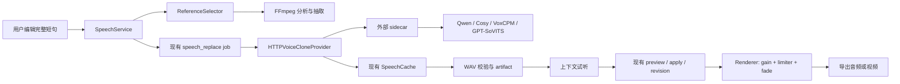

# 局部语音重写：技术调研与详细实现路径

状态：调研完成，尚未开始产品实现

最后核对：2026-08-08

目标仓库：VoxFlow

## 1. 执行结论

这个功能有明确的产品价值，也具备可实施性。最合适的第一版不是“任意音频无痕改字”，而是一个受约束的局部语音重写组件：用户在单人普通话干声中选择一个完整意群或短句，系统用该用户自己的参考语音生成 2–3 个候选，用户听过带上下文的预览后再应用。

推荐技术路线是：

1. 用 zero-shot voice-clone TTS 重新生成完整短句；
2. 用 FFmpeg 做参考音频分析、格式规范化、受限响度匹配和 5–20ms 边界淡化；
3. 继续复用 VoxFlow 已有的 job、artifact、cache、preview/apply、revision 和 renderer；
4. 把模型及 Torch/CUDA/MPS 依赖放在独立 HTTP sidecar 或云服务中；
5. VoxFlow 主仓只增加一个通用 `HTTPVoiceCloneProvider`、参考选择器和少量 DSP。

不建议第一版采用 speech inpainting、声源分离、完整 DAW timeline、自动音素级对齐或口型同步。这些能力会显著放大系统规模，却不能解决第一版的主要质量风险：音色相似、韵律连续和接缝是否可察觉。

模型选择建议：

- 当前 Apple M5 / 32GB 本机实验首选 **VoxCPM2 MPS**；其官方明确支持 MPS、参考音频克隆和参考音频+文本的高保真克隆。
- NVIDIA 质量对照首选 **Qwen3-TTS 0.6B Base**，其次 **Fun-CosyVoice3**。
- **GPT-SoVITS** 和现有 **IndexTTS** 保留为成熟基线。
- 需要最快验证云端质量上界时，可用 **豆包声音复刻 2.0** 或 DashScope 已注册音色；但它们需要单独的授权、上传和计费流程。
- Fish Audio S2、F5-TTS 可以用于非商业质量对照，但当前官方许可不适合作为默认商业依赖。

最终 Go/No-Go 不应由模型 demo 决定，而应由同一批授权中文样本的前三候选成功率、内容正确率、接缝盲听和本地资源实测决定。

## 2. 第一版功能范围

### 2.1 支持范围

- 单个说话人；
- 普通话为主；
- 原始素材近似干声，无 BGM、明显混响或持续环境噪声；
- 音频项目优先；
- 视频只支持不要求正脸口型同步的旁白、录屏或画外音；
- 默认替换完整意群、分句或 1–10 秒短句；
- 每次生成 2–3 个候选，试听后才 apply；
- 只克隆用户本人或已取得明确授权的声音；
- 本地 provider 默认不上传音频，云 provider 必须明确提示数据离开设备。

### 2.2 明确不支持

- 多说话人重叠、抢话、笑声或呼吸中间的局部替换；
- 背景音乐、强噪声、明显房间混响；
- 单字或音素级“无痕手术”；
- 自动修复 BGM/room tone；
- 正脸视频口型同步；
- 训练、微调和模型权重管理平台；
- 未试听即覆盖原音；
- 未经授权的第三方声音模仿；
- 自动注册云端克隆音色。

### 2.3 推荐交互

1. 用户编辑转写文本。
2. 如果选区过短，系统把实际替换范围扩展到完整短句，并显示扩展后的范围。
3. 系统展示自动选择的 5–8 秒参考音频及其转写；参考文本不准确时，用户先修正转写。
4. 系统生成 2–3 个候选，展示自然时长、与原片段时长比、provider 和风险提示。
5. 用户可试听候选本身，以及前后各约 1.5 秒的上下文预览。
6. 用户选中候选后，VoxFlow 先执行 edit preview，再 apply 到新 revision。

## 3. 为什么选择“整句 TTS + 轻量拼接”

直接 speech editing/inpainting 在研究上很吸引人，但本轮没有找到一个同时满足下列条件的成熟依赖：

- 普通话质量稳定；
- zero-shot 音色保持；
- 能处理任意改写文本；
- 有稳定的本地或 HTTP 接口；
- 可作为轻量依赖；
- 许可清晰且适合产品使用。

相反，中文 voice-clone TTS 已有多条可部署路线。重写完整短句还能避免几个最难的问题：

- 不必在一个音节内部切开波形；
- 不必精确预测单个新字的音素时长；
- 模型可以生成完整的停顿、重音和语调；
- 失败时容易让用户换候选或扩大替换范围；
- 现有 VoxFlow replacement clip 已能承载结果。

因此第一版的主要研发工作应放在参考质量、候选策略、上下文试听和接缝处理上，而不是自行实现新的语音模型。

## 4. 现有 VoxFlow 基础与缺口

### 4.1 已有能力

- `SpeechService` 可为 clip 创建持久化 `speech_replace` job；
- worker 可抽取参考音频、调用 provider、缓存 WAV 并创建 replacement artifact；
- replacement candidate 已支持试听、preview/apply 和 revision；
- 音频支持 `natural` ripple；
- 视频支持 `fit_source` 和显式 `pad_or_trim`；
- renderer 已能把 source clips 和 replacement clips 编译为 FFmpeg filter graph；
- cache key 已包含 provider、版本、参考身份、文本和参数。

### 4.2 需要修复的具体问题

1. Provider 只有 `text/output_path/reference_path/parameters`，没有结构化的 `reference_text`、语言、上下文、seed、候选序号和 capability。
2. `IndexTTSProvider` 当前直接丢弃 `parameters`。
3. 参考音频仅按同 speaker clip 的时长排序，拼够约 5 秒；多个不连续片段被硬 concat。
4. 高质量 clone 所需的“参考音频—准确文本”对齐没有进入 job schema 和 cache fingerprint。
5. renderer 只做格式统一后硬 concat，没有局部 gain matching、limiter 或 fade。
6. fake provider 测试只能证明流程正确，不能证明真实音色、韵律和接缝质量。

这些缺口集中在 provider request、reference selection 和 replacement render chain 三处。无需新增多轨、声音资产数据库或模型管理子系统。

## 5. 模型与服务调研

以下结论来自官方仓库、模型文档或厂商文档，核对日期为 2026-08-08。不同模型自报的 WER、SIM、RTF 不能直接横向比较，排序仍需统一样本盲测。

| 候选 | 克隆输入与中文能力 | 部署形态 | 许可判断 | 实施建议 |
|---|---|---|---|---|
| [Qwen3-TTS](https://github.com/QwenLM/Qwen3-TTS) | 0.6B/1.7B Base；约 3 秒参考；高质量模式为 `ref_audio + ref_text`；`x_vector_only_mode` 可不传文本但官方提示质量下降 | 官方 Python 包；`create_voice_clone_prompt` 可缓存参考表征；当前官方 vLLM-Omni 说明仍只支持离线 Qwen3-TTS 推理；另有 DashScope 云 API | 仓库 Apache-2.0，仍需锁定具体模型 revision | NVIDIA 第一候选；0.6B 先测 |
| [Fun-CosyVoice](https://github.com/QwenAudio/CosyVoice) | zero-shot 为 target text + prompt text + 16k prompt speech；中文、方言、拼音纠音和指令能力强 | 官方 Python、FastAPI、gRPC、Docker；可缓存 zero-shot speaker 表征 | Apache-2.0 | 生产可控性候选；人名/术语场景有价值 |
| [VoxCPM2](https://github.com/OpenBMB/VoxCPM) | 2B；30 种语言和中文方言；仅参考音频的 controllable clone；`prompt_wav + prompt_text` 的 ultimate clone；48k 输出 | 官方 Python/CLI/MPS；Nano-vLLM；vLLM-Omni；llama.cpp-omni GGUF/Metal | 代码和权重 Apache-2.0，官方明确 commercial-ready | 当前 M5 本机第一候选 |
| [GPT-SoVITS](https://github.com/RVC-Boss/GPT-SoVITS) | 约 5 秒 zero-shot；约 1 分钟 few-shot；请求包含参考音频、参考文本和语言 | 自带 `api_v2.py`、Docker Compose；支持 Apple Silicon MPS/CPU | 代码 MIT；上线前核对随附权重和资源 | 成熟 API 基线 |
| [Spark-TTS](https://github.com/SparkAudio/Spark-TTS) | 0.5B；中英 zero-shot；CLI 接受 prompt audio + prompt text | Python CLI/Web UI；NVIDIA Triton/TensorRT-LLM runtime；官方主平台 Linux | Apache-2.0 | NVIDIA 第二梯队，不作为第一个 adapter |
| [IndexTTS2](https://github.com/index-tts/index-tts) | 中文；speaker 与 emotion 解耦；论文强调 duration control | 可本地部署，VoxFlow 已有外部服务 adapter | 商业使用需联系作者；精确时长发布状态需按版本核对 | 保留现有对照，不作为架构前提 |
| [GLM-TTS](https://github.com/zai-org/GLM-TTS) | 中文为主；3–10 秒参考；强调情绪表现 | 本地 GPU/NPU | Apache-2.0 | 平稳口播场景的第二梯队 |
| [Fish Audio S2](https://github.com/fishaudio/fish-speech) | S2-Pro 4B；中文；典型 10–30 秒参考；内容与表达能力强 | Python/SGLang-Omni/云服务 | 2026 Fish Audio Research License 明确商业使用需另签协议 | 只作非商业质量上界对照 |
| [F5-TTS](https://github.com/SWivid/F5-TTS) | 中文/英文 zero-shot；模型较小，社区成熟 | Python、CLI、Gradio、Docker；有 Apple Silicon 说明 | 代码 MIT，但官方预训练模型为 CC-BY-NC | 只作非商业实验基线 |
| [豆包声音复刻 2.0](https://www.volcengine.com/docs/6561/1167802) | 上传授权录音训练音色，之后用 speaker ID 合成；资源 ID `seed-icl-2.0` | 云 API | 计费服务，需声音复刻协议和音色槽位 | 云端质量上界或回退，不是 local-first 默认 |

### 5.1 各官方接口对统一协议的映射

#### Qwen3-TTS

官方高质量调用为：

```python
prompt = model.create_voice_clone_prompt(
    ref_audio=reference_wav,
    ref_text=reference_text,
    x_vector_only_mode=False,
)
wavs, sample_rate = model.generate_voice_clone(
    text=target_text,
    language="Chinese",
    voice_clone_prompt=prompt,
)
```

sidecar 启动时加载模型，以 `model_revision + reference_sha256 + reference_text_sha256` 为 key 做小型 LRU prompt cache。VoxFlow 不需要了解 Qwen tensor 或 tokenizer。

#### Fun-CosyVoice

官方 FastAPI `/inference_zero_shot` 接收 multipart：

- `tts_text`；
- `prompt_text`；
- `prompt_wav`。

官方示例响应是流式 int16 PCM，并没有 WAV header 或自描述采样率。实验时可直接依赖官方 server；正式 adapter 应把 PCM 封装成 WAV，并显式返回 sample rate。官方 server 默认允许任意 CORS 且示例监听 `0.0.0.0`，本地部署时不应原样暴露。

#### VoxCPM2

推荐使用 ultimate clone：

```python
wav = model.generate(
    text=target_text,
    prompt_wav_path=reference_wav,
    prompt_text=reference_text,
    reference_wav_path=reference_wav,
    seed=seed,
)
```

同一参考音频同时作为 prompt 和 reference 是官方建议的高相似路径。Apple Silicon 可先用官方 `device=auto/mps`；若 Python/MPS 依赖不稳定，再用 llama.cpp-omni 的 GGUF/Metal CLI 包一层进程 adapter。

vLLM-Omni 的标准 `/v1/audio/speech` 示例目前只显示 `model/input/voice`。在没有 clone 扩展字段证据前，不把该端点视为完整克隆接口。

#### GPT-SoVITS

官方 `api_v2.py` 的 `POST /tts` 最小字段为：

```json
{
  "text": "目标文本",
  "text_lang": "zh",
  "ref_audio_path": "/sidecar-local/reference.wav",
  "prompt_text": "参考音频准确文本",
  "prompt_lang": "zh",
  "seed": 42,
  "speed_factor": 1.0,
  "media_type": "wav",
  "streaming_mode": false
}
```

其官方 API 接受服务端本地路径，因此统一 sidecar 收到 multipart 后需要先写入自己的临时目录，再调用 `/tts` 或内部 pipeline。VoxFlow 不向模型服务传任意宿主路径。

#### 豆包声音复刻

豆包不是“一次请求带参考音频”的 zero-shot 接口，而是两阶段声音资产流程：

1. 开通声音复刻与音色服务；
2. 上传已授权录音并训练；
3. 查询训练状态并取得 speaker ID；
4. 用 `seed-icl-2.0` 和 speaker ID 调用 TTS。

项目级 `doubao-tts` skill 目前只负责使用预置或已注册 speaker 合成，不负责训练注册。这个边界是正确的；不要把授权和计费操作藏进普通 speech replacement job。

对复制到本项目的 skill 做过前向流程审阅后，还确认了以下边界：

- 已注册音色使用 `DOUBAO_RESOURCE_ID=seed-icl-2.0` 与 `DOUBAO_SPEAKER=<speaker-id>`；
- 凭据从 `.env`/环境读取，不应出现在命令行；
- 首次云端请求前必须确认目标文本允许发送；
- skill 只生成 raw 音频和 timing/events sidecar，不负责拉伸和局部拼接；
- 当前脚本没有 speaker 状态检查，也不负责音色授权、计费或注册；
- `.env` 依赖当前工作目录查找，正式集成前应改为显式配置路径，避免误载其他项目凭据；
- API key 与 legacy app credentials 的优先级应在配置诊断中明确显示，但不得输出凭据值。

## 6. 推荐轻量架构



### 6.1 职责边界

VoxFlow 负责：

- 选择和校验参考片段；
- 组装版本化请求；
- job、超时、取消、cache 和 artifact；
- 生成候选、上下文预览和风险提示；
- preview/apply/revision；
- duration policy 和最终 FFmpeg 渲染。

sidecar 负责：

- 一次加载模型和权重；
- 把统一请求映射到模型原生 API；
- 可选 prompt embedding LRU cache；
- 输出自描述 WAV；
- 暴露 readiness、capabilities 和版本；
- 不持久保存用户音频，除非 provider 配置明确声明。

VoxFlow 不负责：

- 下载、升级或训练模型；
- CUDA/MPS 环境解析；
- 模型专有的 tensor、tokenizer 和 checkpoint 管理；
- provider 内部批处理和多 GPU 调度；
- 云端声音注册控制面。

### 6.2 为什么用 HTTP multipart

- 不共享宿主绝对路径，避免 path traversal 和容器挂载耦合；
- 同一 provider client 可连接 localhost、Docker 或远端受控服务；
- 5–8 秒 16kHz mono PCM 参考通常不足 300KB，multipart 成本很小；
- 模型原生服务变化只影响 sidecar adapter；
- VoxFlow 主环境不安装 Torch、模型 SDK 或数 GB 权重。

## 7. 统一 sidecar 协议草案

协议名：`voxflow.voice-clone.v1`。

### 7.1 Readiness

`GET /readyz`

```json
{
  "ready": true,
  "schema_version": 1,
  "provider": "voxcpm",
  "model": "openbmb/VoxCPM2",
  "model_revision": "pinned-commit-or-weight-sha",
  "device": "mps"
}
```

`ready=false` 可以表示进程存活但模型尚未加载。health 请求必须快速，不触发模型下载。

### 7.2 Capabilities

`GET /v1/capabilities`

```json
{
  "schema": "voxflow.voice-clone.v1",
  "provider": "voxcpm",
  "provider_version": "0.1.0",
  "model": "openbmb/VoxCPM2",
  "model_revision": "pinned-revision",
  "modes": ["voice_clone"],
  "languages": ["zh-CN", "auto"],
  "requires_reference_audio": true,
  "requires_reference_text": true,
  "supports": {
    "seed": true,
    "speed": false,
    "instruction": true,
    "prompt_cache": false,
    "cooperative_cancel": false
  },
  "limits": {
    "reference_seconds_min": 3,
    "reference_seconds_max": 12,
    "target_characters_max": 200,
    "request_bytes_max": 2097152,
    "concurrency": 1
  },
  "output": {
    "content_type": "audio/wav",
    "sample_rates": [48000],
    "channels": [1]
  },
  "data_residency": "local"
}
```

VoxFlow 启动 job 前缓存 capabilities，并把 `provider/model/model_revision/schema` 写入 artifact metadata。能力不支持时在请求前失败，不能静默忽略 speed、seed 或 reference text。

### 7.3 Synthesis

`POST /v1/speech`，`multipart/form-data`：

- `request`：`application/json`；
- `reference_audio`：`audio/wav`。

`request` 示例：

```json
{
  "schema": "voxflow.voice-clone.v1",
  "request_id": "job-id:candidate-1",
  "text": "我们把发布日期调整到下周三。",
  "language": "zh-CN",
  "reference": {
    "sha256": "hex-sha256",
    "text": "这是参考录音中与音频严格对应的文本。",
    "text_sha256": "hex-sha256"
  },
  "context": {
    "before_text": "上一句话，只用于可选韵律提示和诊断。",
    "after_text": "下一句话，只用于可选韵律提示和诊断。"
  },
  "generation": {
    "seed": 1042,
    "candidate_index": 1,
    "speed": 1.0,
    "instruction": null
  },
  "output": {
    "format": "wav"
  }
}
```

成功响应：

- HTTP 200；
- `Content-Type: audio/wav`；
- 完整、非流式 WAV；
- 可选响应头：`X-VoxFlow-Model-Revision`、`X-VoxFlow-Prompt-Cache`、`X-VoxFlow-Inference-Ms`。

第一版不要求 sidecar 流式返回，因为用户要的是短句候选，VoxFlow 已有持久化 job。非流式 WAV 更容易校验、缓存和重试。

### 7.4 错误格式

使用 `application/problem+json`：

```json
{
  "type": "urn:voxflow:voice-clone:reference-rejected",
  "title": "Reference audio was rejected",
  "status": 422,
  "code": "reference_too_short",
  "detail": "At least 3 seconds of voiced audio is required",
  "retryable": false
}
```

建议状态码：

| 状态 | 语义 |
|---|---|
| 400 | schema、文本或参数非法 |
| 413 | reference/request 超限 |
| 422 | 参考音频不满足模型要求 |
| 429 | sidecar 达到并发上限，返回 `Retry-After` |
| 503 | 模型未 ready 或设备不可用 |
| 504 | 模型推理超时 |

### 7.5 超时、取消和并发

- connect timeout：5 秒；
- 第一版的读取超时为 180 秒，并允许通过配置调整；
- sidecar 默认并发 1，忙时返回 429，不在显存不足后排无限队列；
- VoxFlow 仍是唯一 job owner，sidecar 不再实现第二套异步 task API；
- HTTP client 使用 streaming download，逐块检查 VoxFlow job 的 `cancel_requested`；取消时关闭连接并删除 `.partial.wav`；
- 可选能力 `cooperative_cancel=true` 时，VoxFlow 再调用 `DELETE /v1/requests/{request_id}`；
- 只在“尚未成功连接或服务明确标记 retryable”时自动重试一次；推理已开始后不做透明重试；
- 每个请求带稳定 request ID，日志中只记录 digest、耗时和大小，不记录参考文本、目标文本或音频内容。

### 7.6 sidecar 内缓存

sidecar 只做进程内 LRU prompt cache：

```text
key = model_revision
    + reference_audio_sha256
    + reference_text_sha256
    + clone_mode
```

初始最多 8 个 entry，进程退出即丢失。VoxFlow 的磁盘 `SpeechCache` 继续缓存最终 WAV，因此不需要新增声音资产数据库。

## 8. Provider request v2

建议在 VoxFlow 内定义严格模型，而不是继续扩大开放 `parameters` 字典：

```python
class SpeechSynthesisRequestV2:
    text: str
    language: str
    output_path: Path
    reference_path: Path
    reference_text: str
    reference_audio_sha256: str
    before_text: str | None
    after_text: str | None
    seed: int | None
    candidate_set_id: str
    candidate_index: int
    speed: float | None
    instruction: str | None
```

provider interface 变为：

```python
class SpeechProvider(Protocol):
    name: str
    version: str

    def capabilities(self) -> SpeechProviderCapabilities: ...
    def synthesize(self, request: SpeechSynthesisRequestV2) -> None: ...
```

开放的 `parameters` 可暂时保留用于向后兼容，但只能接受服务端白名单，并在进入 cache key 前规范化。模型专有参数如 `top_k`、`cfg_value`、`inference_timesteps` 不应进入第一版公共 API。

## 9. 参考音频选择与质量门

### 9.1 选择原则

第一版默认选择一个连续的原音范围，而不是拼接多个不连续片段：

1. 从当前 revision 中取同 speaker、`kind=source`、不与目标范围重叠的片段；
2. 按原始 source 时间排序，而不是 timeline 展示顺序；
3. 将 source gap 不超过 300ms 的相邻片段组成连续窗口；
4. 枚举 3–12 秒窗口，优先 5–8 秒；
5. reference text 按相同窗口中的 transcript 顺序拼接；
6. 跑一次 FFmpeg 轻量分析；
7. hard reject 后按 soft score 选最高项；
8. 没有合格窗口时返回 `reference_required`，不要偷偷使用低质量片段。

如果用户显式选择 reference clips，服务端仍需验证它们来自同一 project、同一 speaker、连续、未覆盖目标，并重新运行质量门。

### 9.2 初始 hard reject

这些是实验初值，不是行业标准，必须在统一样本上校准：

- 总时长小于 3 秒或大于 12 秒；
- 有效非静音时长小于 3 秒；
- `-45dB`、持续至少 250ms 的静音总占比超过 20%；
- NaN 或 Inf 样本；
- peak ≥ -0.1dBFS 且 absolute peak count 异常高，疑似削波；
- reference text 为空；
- reference text 与时长明显不相称；
- 与目标 source range 重叠；
- 用户或项目已标记为 BGM、强混响或多人重叠。

FFmpeg 不能可靠判断“这是房间混响”或“这是 BGM”。第一版对这两项应采用功能范围限制和用户确认，不应伪装成可靠的自动检测。

### 9.3 Soft rank

建议初始分数：

```text
score = duration_score(5–8s 最优)
      + continuity_bonus
      + same_channel_bonus
      + proximity_score
      + target_rms_similarity
      - silence_penalty
      - clipping_penalty
```

优先级高于精确权重：

1. 单个连续窗口；
2. 5–8 秒；
3. 同一录音通道；
4. 与目标片段 RMS 接近；
5. 距目标较近；
6. 文本准确且包含完整意群。

不要用 `silenceremove` 删除内部停顿；只允许裁掉头尾明显长静音，否则 reference text 与音频失配。

### 9.4 FFmpeg 分析命令

抽取一个连续 16kHz mono PCM reference：

```bash
ffmpeg -v error -ss START -to END -i source \
  -map 0:a:0 -ac 1 -ar 16000 -c:a pcm_s16le reference.wav
```

静音：

```bash
ffmpeg -hide_banner -i reference.wav \
  -af 'silencedetect=n=-45dB:d=0.25' -f null -
```

幅度和异常样本：

```bash
ffmpeg -hide_banner -i reference.wav \
  -af 'astats=metadata=1:reset=0' -f null -
```

实现中必须直接以参数数组调用 subprocess，不经过 shell；解析结构化字段，并把 FFmpeg 版本和分析阈值版本写入 metadata。

## 10. 候选、上下文和缓存

### 10.1 候选生成

每个候选仍是一个独立现有 job：

- UI 生成一个 `candidate_set_id`；
- 对同一 target/reference 发起 3 个 `speech_replace` job；
- `candidate_index` 为 0、1、2；
- provider 支持 seed 时，用显式 `base_seed + index`；
- provider 不支持 seed 时仍把 candidate index 纳入请求 digest，避免三个请求错误命中同一缓存；
- 任一候选可以独立取消、失败、重试和缓存；
- 不新增 candidate-set 数据表，分组字段写入 job 和 artifact metadata。

这样可以保持现有 job 状态机、worker 和 artifact 语义不变。

### 10.2 上下文的真实用途

大多数首选模型并没有统一的 `before_text/after_text` 参数。第一版不要把整段上下文送给模型再尝试裁出目标句，这会引入强制对齐和裁切误差。

上下文用于：

- 生成前后文预览；
- 记录说话速度和标点环境；
- 将来 provider 明确声明支持时作为韵律提示；
- 评测接缝，而不是冒充统一模型能力。

目标文本应包含完整标点。不得在 provider adapter 中静默改写用户文本；拼音、人名或数字规范化必须作为可见的文本预处理结果展示给用户。

### 10.3 Cache key v2

```text
provider_schema_version = 2
provider name/version
model id/revision
target text + language
reference audio sha256
reference text sha256
reference source ranges
seed + candidate index
speed + instruction
output format
DSP profile version
```

所有会改变输出的字段必须进入 key。旧 v1 cache 不迁移，直接自然 miss；不要尝试猜测旧 artifact 是否具有准确 reference text。

## 11. 接缝 DSP 与时长

### 11.1 第一版处理顺序

对 replacement 的处理顺序：

1. 读取候选 WAV 并用 ffprobe 验证格式、时长、可解码性和最大大小；
2. 对原目标 clip 和候选分别测 voiced RMS/peak；
3. 计算 `gain_db = clamp(target_rms_db - candidate_rms_db, -6, +6)`；
4. 应用受限线性 gain；
5. 应用 peak limiter，建议初始上限 -1dBFS；
6. 按 duration policy 做 `atempo` 或 pad/trim；
7. 在最终 replacement 头尾做 5–20ms fade；
8. 与 source clips concat；
9. 不对整片重复做全局 loudnorm。

建议初始 fade 为 8–12ms，并限制为 replacement 最终时长的四分之一以内。具体值由接缝听测校准。

### 11.2 为什么不用默认 acrossfade

FFmpeg `acrossfade` 默认 overlap，会让两个输入总时长减少 fade duration。replacement 左右各做一次会改变 timeline 时长；关闭 overlap 又容易形成能量谷。

第一版默认使用 replacement 自身的短 `afade`，它不会改变时长。它不是理论上最无痕的方案，但在干声和自然停顿边界上可预测、易测试。只有在后续能安全提取边界 room tone 时，才增加保持总时长的 overlap-aware crossfade。

示意 filter chain：

```text
atrim
→ asetpts
→ volume=<bounded gain>
→ alimiter=limit=0.891251:level=false:latency=true
→ atempo / apad / atrim
→ afade=in
→ afade=out
→ aresample=44100
→ stereo normalize
```

`loudnorm` dynamic 模式会为 true peak 上采样到 192kHz；对每个 1–10 秒候选既重又不稳定。`ebur128` 的 momentary 窗约 400ms、short-term 窗约 3 秒，短句更适合把局部 RMS/peak 作为渲染参数，把 LUFS 仅作为诊断数据。

### 11.3 Duration policy

| Policy | 第一版行为 | 建议 |
|---|---|---|
| `natural` | 使用模型自然时长，音频 timeline ripple | 音频默认；通常最自然 |
| `fit_source` | 通过 `atempo` 适配原时长 | 视频默认；只在安全比值内自动使用 |
| `pad_or_trim` | 补静音或显式裁切 | 仅用户明确选择；显示强警告 |

保留现有安全范围 0.8–1.25。超出范围时：

- 音频建议切换 `natural`；
- 视频建议重新改写文本或换候选；
- 不要静默做极端 time stretch；
- 不要承诺口型同步。

### 11.4 DSP metadata

不增加 timeline 字段。把下列信息写入 replacement artifact metadata：

```json
{
  "dsp_profile": "speech-rewrite-v1",
  "target_rms_db": -20.4,
  "candidate_rms_db": -24.1,
  "gain_db": 3.7,
  "peak_limit_db": -1.0,
  "fade_in_ms": 10,
  "fade_out_ms": 10,
  "analysis_version": 1
}
```

renderer 读取 artifact metadata 并编译 filter chain。这样现有 `TimelineClip` 只保留 artifact ID、duration 和 policy，不膨胀 domain schema。

## 12. 详细代码改造路径

### 12.1 新增严格契约

建议新增 `voxflow/domain/speech.py`：

- `SpeechSynthesisRequestV2`；
- `SpeechProviderCapabilities`；
- `ReferenceCandidate`；
- `ReferenceAnalysis`；
- `RenderDSPProfile`。

所有模型必须 `extra=forbid`。语言、candidate count、speed 和 reference 范围在 application 层验证，不把任意 JSON 直接发给 sidecar。

### 12.2 扩展 application service

修改 `voxflow/application/speech.py`：

- 默认只接受完整 clip；token/短语选择先扩成完整 clip；
- 从 transcript/timeline 构造连续 reference windows；
- 生成准确 `reference_text`；
- 接受可选 `candidate_set_id/candidate_index/seed`；
- 保存 `before_text/after_text`，但不假设 provider 会使用；
- job request 的 `provider_schema_version` 升为 2；
- 没有合格 reference 时返回结构化错误和修复建议。

### 12.3 增加轻量音频分析

建议新增 `voxflow/infrastructure/audio_analysis.py`：

- `extract_contiguous_reference(...)`；
- `analyze_reference(...)`；
- `analyze_loudness_window(...)`；
- 只调用现有 FFmpeg/ffprobe；
- 使用 subprocess 参数数组；
- 设 30–120 秒上限；
- 解析失败时 fail closed；
- 不引入 librosa、numpy、VAD 模型或 source separation。

现有 `extract_reference_audio` 的多段 concat 路径可保留给旧 schema v1，但 v2 只允许单个连续 range。

### 12.4 新增通用 HTTP provider

修改 `voxflow/infrastructure/speech.py`：

- 新增 `HTTPVoiceCloneProvider`；
- `GET /readyz` 和 `/v1/capabilities`；
- multipart `POST /v1/speech`；
- connect/read timeout；
- 最大响应大小；
- streaming 写 `.partial.wav`；
- cancellation check；
- content-type、WAV header 和 provider error 验证；
- 不接受 sidecar 返回的任意文件路径；
- 现有 IndexTTS 作为 legacy provider，之后可通过 adapter 迁移。

配置建议：

```text
VOXFLOW_TTS_PROVIDER=http_voice_clone
VOXFLOW_TTS_SERVICE_URL=http://127.0.0.1:8899
VOXFLOW_TTS_CONNECT_TIMEOUT_SECONDS=5
VOXFLOW_TTS_TIMEOUT_SECONDS=180
VOXFLOW_TTS_MAX_RESPONSE_MB=25
```

不要把 token 放在 URL 中。远端 provider 使用 `Authorization` header，并在 diagnostics 中脱敏。

### 12.5 修改 worker 与 cache

修改 `voxflow/worker.py` 和 `voxflow/infrastructure/speech_cache.py`：

- 抽取单个连续 reference；
- 保存 reference WAV sha256 和 reference text sha256；
- 用 request v2 调 provider；
- provider 调用前后检查 cancel；
- 校验结果 WAV；
- 分析 candidate RMS/peak；
- 生成 `RenderDSPProfile`；
- cache key 升 v2；
- metadata 保存 provider/model revision、seed、候选序号、耗时和 DSP；
- 任意失败都删除 partial，不产生半成品 artifact。

### 12.6 修改 renderer

修改 `voxflow/infrastructure/renderer.py`：

- replacement input 从 `artifact_id -> Path` 扩展为内部 `ReplacementAsset`，包含 path 和 DSP metadata；
- 只在 replacement chain 加 gain、limiter 和 fade；
- 先做 duration policy，再按最终 duration 计算 fade-out start；
- 保证 `natural/fit_source/pad_or_trim` 时长测试继续通过；
- source-only 快路径和长文件 `asegment` 优化不受影响；
- 不对最终整片再做 loudnorm。

### 12.7 API、CLI、MCP 和 Web

保持现有入口，不新增第二套工作流：

- `voxflow/interfaces/web/api_v1.py`：现有 speech replacement endpoint 增加白名单字段；
- `voxflow/interfaces/cli/main.py`：`speech replace-start` 增加 reference/seed/candidate 参数；
- `voxflow/interfaces/mcp/server.py`：同步严格 schema；
- Web：默认发起 3 个独立 job，按 `candidate_set_id` 分组；显示 reference、候选时长、风险和上下文试听；
- apply 仍提交现有 `attach_speech_replacement` operation；
- 旧客户端不传新字段时仍按 `candidate_count=1` 工作。

上下文 preview 可先作为受控临时 endpoint 生成和缓存，不需要加入 timeline。若持久化为 artifact，必须在 metadata 标记 `role=context_preview`，并禁止它被 attach 为 replacement。

### 12.8 Sidecar 放置方式

VoxFlow 主仓不包含模型权重和完整推理代码。建议：

- 每个 sidecar 是独立目录、独立 uv/conda 环境或 Docker image；
- adapter 代码控制在一个 server 文件和一个 provider 映射文件；
- requirements 直接 pin 上游仓库 commit 或发布版本；
- 模型下载由 sidecar README 中的显式命令完成；
- sidecar 可以放在独立仓库；VoxFlow 只维护协议和一份最小参考实现；
- 首个参考实现选择 VoxCPM2，第二个选择 Qwen3-TTS，用两种实现验证协议没有模型偏置。

## 13. 安全、隐私和滥用边界

- 首次使用前要求用户确认“这是本人声音或已获得声音权利人的明确授权”；
- 云 provider 每次首次发送 reference 前显示供应商、用途和数据离开设备提示；
- 默认 sidecar 仅绑定 `127.0.0.1`；
- 不启用宽泛 CORS，浏览器不直接访问 sidecar；
- reference 通过 multipart bytes 发送，不传任意本地路径；
- 限制 request 大小、reference 时长、目标字符数和响应大小；
- 临时 reference 使用 job 私有目录，成功或失败后清理；
- 不在日志、diagnostics bundle 或错误消息中包含原文、音频 bytes、Authorization 或签名 URL；
- artifact 保留与其他项目媒体相同的本地访问控制和生命周期；
- 第一版不提供公开的声音市场、speaker ID 分享或批量生成接口；
- 产品文档明确“生成结果可能存在内容和身份误导风险”，发布行为仍由用户决定。

## 14. 真实评测方案

### 14.1 样本集

- 4 位已授权说话人，尽量男女各半；
- 每人 5 段普通话干声；
- 每段 15–40 秒；
- 每个说话人固定 5–8 秒准确 reference；
- 四类修改：人名/数字、短语、完整短句、明显变长短句；
- 至少 80 个 target case；
- 所有 provider 使用相同 reference、文本、边界和 duration policy；
- 样本、授权、模型 revision 和命令写入可重跑 manifest。

### 14.2 必须分开的指标

| 维度 | 测量方式 | 说明 |
|---|---|---|
| 内容正确 | 同一 ASR 的 CER + 人名/数字人工复核 | 人名数字不能只看平均 CER |
| 音色相似 | 固定 speaker embedding cosine | 仅辅助，不能代替人听 |
| 自然度 | 随机盲听 1–5 分 | 单独评价候选本身 |
| 接缝可察觉率 | 前句+替换+后句上下文 ABX/定位 | 这是本功能核心指标 |
| 韵律连续性 | 语速、音高、情绪、停顿分项标签 | 解释失败原因 |
| 候选命中率 | 前 1/2/3 个候选中是否有可导出结果 | 直接对应产品体验 |
| 时长适配 | 自然时长比、安全 stretch 占比 | 决定音频/视频可用性 |
| 性能 | cold start、warm latency、RTF、峰值内存 | Mac 与 NVIDIA 分开报 |
| 稳定性 | timeout/OOM/空 WAV/损坏 WAV 比例 | 不能只保留成功样本 |
| 缓存 | 最终 WAV cache 与 prompt cache 命中 | 验证重复编辑成本 |

接缝失败标签至少包括：音量跳变、底噪变化、语速突变、音高/情绪突变、停顿不自然、爆音/点击、内容错误、时长不可接受。

### 14.3 建议 Go 门槛

首轮实验门槛：

- 至少 80% 的干声短句 case 能在 3 个候选内得到“愿意导出”的结果；
- 人名和数字人工复核错误接近 0；
- 大多数自然时长落在原片段 0.8–1.25 倍；
- 无爆音、削波、静音洞或明显音量跳变；
- 听者不能稳定定位 replacement 边界；
- warm RTF 足以让 1–10 秒候选在可接受交互时间内生成；
- 本地 provider 没有 reference 音频出站请求；
- 云 provider 的授权提示和失败清理可验证。

建议把“可接受交互时间”和主观听测的具体数值在第一次 80-case 基线后冻结，而不是现在凭空指定。

### 14.4 No-Go 条件

出现任一条件时，不进入公开测试：

- 三候选成功率仍明显低于 80%；
- 人名/数字经常读错；
- 需要依赖极端 time stretch 才能使用；
- 接缝可被多数听者稳定定位；
- 默认模型许可或权重来源不清楚；
- 本地模式发生未声明音频上传；
- sidecar OOM 会拖垮 VoxFlow 主进程或留下损坏 artifact。

## 15. 分阶段实施计划

### Phase 0：隔离模型 bake-off，不改产品主流程

目标：先证明模型质量和本机可行性。

1. 准备 2 位授权说话人的 12 个小样本。
2. 在仓库外独立环境安装 VoxCPM2 MPS。
3. 记录安装版本、模型 revision、cold/warm 时延、RTF 和峰值内存。
4. 用同一 reference/text 在 Qwen3-TTS 0.6B NVIDIA 环境跑对照；没有 GPU 时可先用外部服务。
5. 可选加入 CosyVoice、GPT-SoVITS 和现有 IndexTTS。
6. 输出 WAV + manifest + 本地盲听页。
7. 只有至少一个模型达到可继续的主观质量，才进入 Phase 1。

预计工程量：2–4 人日，不含模型下载时间和外部 GPU 排队。

### Phase 1：Provider v2 + reference selection

1. 增加严格 request/capability 模型。
2. 实现通用 HTTP provider。
3. 实现连续 reference window 和 FFmpeg quality gate。
4. 升级 job/cache schema v2。
5. 用 fake sidecar 完成 contract、timeout、cancel、size limit 和损坏 WAV 测试。
6. 接入一个真实 sidecar。

预计工程量：3–5 人日。

### Phase 2：三候选 + DSP + 上下文试听

1. 3 个独立 job 和 `candidate_set_id` 分组。
2. candidate/target RMS 分析和 artifact DSP metadata。
3. renderer 增加 gain、limiter、fade。
4. 生成上下文 preview。
5. 覆盖 `natural/fit_source/pad_or_trim` 的时长守恒。

预计工程量：3–5 人日。

### Phase 3：Web 实验功能与 80-case 验收

1. UI 展示实际替换范围、reference、三候选和风险。
2. 加入声音授权与云端数据提示。
3. 跑 80-case 统一评测和盲听。
4. 根据失败标签只调 reference/DSP/候选默认值，不扩产品范围。
5. 满足 Go 门后标记为实验性功能。

预计工程量：2–4 人日，加听测时间。

在模型通过 Phase 0 后，组件本身约 8–14 人日；总计约 10–18 人日。它仍是对现有 replacement 的增量，不是新系统。

## 16. 测试清单

### 单元测试

- 连续 reference window 枚举、排序和 target 排除；
- reference text 与 source range 顺序一致；
- hard reject 和 soft score 边界；
- provider capability 与 request 参数匹配；
- cache key 对 ref text、seed、model revision、DSP version 敏感；
- gain clamp、fade clamp、duration ratio；
- provider problem JSON 到 VoxFlow error 的映射。

### Contract 测试

- `/readyz` 不触发下载；
- capabilities schema；
- multipart 字段和文件名不依赖宿主路径；
- audio/wav、错误 content-type、超大响应、截断响应；
- connect/read timeout；
- 429 + Retry-After；
- cancel 后连接关闭且 partial 被清理；
- 日志和 diagnostics 不泄露文本、token、路径或音频。

### FFmpeg 集成测试

- 8/10/20ms fade 不改变期望时长；
- gain 限制为 ±6dB；
- limiter 后 peak 不超过设定值；
- `fit_source` 在安全比值内达到目标时长；
- `natural` ripple 保持候选自然时长；
- source-only export 字节路径不受影响；
- 多个 replacement、相邻 replacement、首尾 replacement；
- 1 秒极短和 10 秒上限 case；
- MP3/WAV/MP4 均可解码且无 stream 丢失。

### 真实模型 smoke

- 同一 request 在 cache hit 时不再次推理；
- seed 支持者可复现；
- prompt cache hit 可观察但不影响正确性；
- 模型未启动、正在 warmup、OOM、超时、输出空 WAV；
- sidecar 重启不损坏已有 candidate artifact；
- MPS 与 NVIDIA 结果分别记录，不混合性能结论。

## 17. 决策记录

| 决策 | 选择 | 原因 |
|---|---|---|
| 编辑粒度 | 完整意群/短句 | 比单字 splice 稳定，适合当前 timeline |
| 推理依赖 | 外部 sidecar/云服务 | 保持主包轻量，隔离模型环境 |
| 通信 | 同步 HTTP multipart | 参考音频小，协议简单且不共享路径 |
| sidecar task | 不新增 | VoxFlow 已有持久化 job |
| reference | 单个连续 5–8 秒窗口 | 保持音频—文本和韵律连续 |
| 候选 | 3 个独立现有 job | 独立 cancel/cache/retry，无新表 |
| DSP | RMS/peak + gain clamp + limiter + afade | FFmpeg 原生、可测试、时长可守恒 |
| 背景处理 | 第一版直接拒绝 BGM/强噪声/混响 | 比分离和重建更轻、更可靠 |
| 音频时长 | 默认 natural | 最少损伤韵律 |
| 视频时长 | 默认 fit_source，超门限拒绝 | 保持画面长度但不做极端拉伸 |
| 本机首测 | VoxCPM2 MPS | 官方明确 Apple Silicon 路线 |
| NVIDIA 首测 | Qwen3-TTS 0.6B | 轻、中文、参考文本路径清晰 |

## 18. 主要风险与缓解

| 风险 | 影响 | 缓解 |
|---|---|---|
| reference text 不准确 | 克隆质量和内容稳定性下降 | 展示 reference 转写；允许先修正；进入 cache fingerprint |
| 句首句尾韵律不匹配 | 接缝可察觉 | 完整短句、三候选、上下文试听、短 fade |
| 时长差太大 | 视频错位或音频节奏异常 | natural 优先；0.8–1.25 安全门；改文案/换候选 |
| 模型环境冲突 | 主程序安装膨胀或不可用 | 外部 sidecar，pin revision，不装入 VoxFlow |
| MPS 能跑但过慢 | 本机体验差 | 记录 warm RTF；允许 GGUF/Metal 或云 provider |
| 模型许可变化 | 无法商用或分发 | artifact 记录 model revision；发布前逐权重核对 |
| sidecar 暴露公网 | 音频和模型被滥用 | localhost 默认、无宽 CORS、认证、请求限额 |
| 云端隐私 | reference 离开设备 | provider 标记 residency、明确授权、本地默认 |
| 自动指标误导 | 质量决策错误 | CER/SIM/MOS 分开；上下文盲听为核心 |

## 19. 建议立即执行的下一步

最值得先做的不是改 Web UI，而是一个小型、可丢弃的真实模型实验：

1. 准备一位已授权说话人的 5–8 秒 reference、准确文本和 6 个改写句；
2. 在仓库外创建 VoxCPM2 MPS 环境，不改变 VoxFlow 依赖；
3. 生成每句 3 个 seed，记录 cold/warm latency、RTF、内存和 WAV；
4. 用 FFmpeg 拼出前后文 preview；
5. 人工标记内容、音色、韵律和接缝失败；
6. 若结果达到“至少部分 case 可导出”，再实现通用 HTTP contract；
7. 同一 contract 接 Qwen3-TTS 0.6B，验证模型可替换性。

这个顺序能以最低代码成本回答最大的不确定性：模型是否真的能把用户自己的短句改到“愿意发布”的程度。

## 20. 一手来源

### 模型和接口

- [Qwen3-TTS 官方仓库](https://github.com/QwenLM/Qwen3-TTS)
- [Fun-CosyVoice 官方仓库](https://github.com/QwenAudio/CosyVoice)
- [CosyVoice 官方 FastAPI server](https://github.com/QwenAudio/CosyVoice/blob/main/runtime/python/fastapi/server.py)
- [VoxCPM 官方仓库](https://github.com/OpenBMB/VoxCPM)
- [GPT-SoVITS 官方仓库](https://github.com/RVC-Boss/GPT-SoVITS)
- [GPT-SoVITS 官方 api_v2.py](https://github.com/RVC-Boss/GPT-SoVITS/blob/main/api_v2.py)
- [Spark-TTS 官方仓库](https://github.com/SparkAudio/Spark-TTS)
- [IndexTTS 官方仓库](https://github.com/index-tts/index-tts)
- [GLM-TTS 官方仓库](https://github.com/zai-org/GLM-TTS)
- [Fish Speech 官方仓库](https://github.com/fishaudio/fish-speech)
- [Fish Audio Research License](https://github.com/fishaudio/fish-speech/blob/main/LICENSE)
- [F5-TTS 官方仓库与许可说明](https://github.com/SWivid/F5-TTS)

### 云服务

- [豆包声音复刻下单及使用指南](https://www.volcengine.com/docs/6561/1167802)
- [豆包 TTS 接口资源说明](https://www.volcengine.com/docs/6561/1598757)
- [Qwen3-TTS DashScope voice cloning 文档入口](https://help.aliyun.com/zh/model-studio/qwen-tts-voice-cloning)

### 音频处理

- [FFmpeg Filters 官方文档](https://ffmpeg.org/ffmpeg-filters.html)
- 相关 filter：`astats`、`silencedetect`、`afade`、`acrossfade`、`alimiter`、`atempo`、`loudnorm`、`ebur128`

## 21. 事实与提案边界

文档中模型参数、原生 API、部署支持和许可证来自上述官方来源。以下内容是 VoxFlow 的工程提案，尚未通过真实数据冻结：

- reference 5–8 秒最优、3–12 秒 hard range；
- 静音阈值、20% 静音占比和削波阈值；
- gain ±6dB、-1dBFS limiter、8–12ms 默认 fade；
- 0.8–1.25 自动时长适配范围；
- 三候选和 80% Go 门；
- timeout、LRU 大小和并发默认值。

这些数值必须在 Phase 0–3 的统一样本上校准。文档没有把模型厂商 demo、单个 benchmark 或本机硬件规格当成最终产品质量证据。
